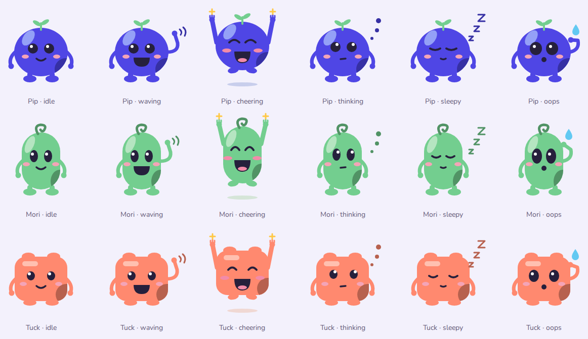
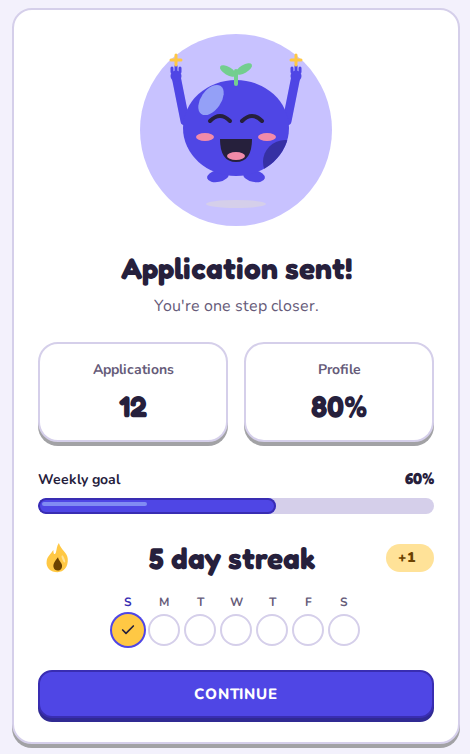

# Kumiko

Kumiko (`kumiko-ui`) is a playful React component library in the spirit of Duolingo. Buttons press down onto a
darker edge, type is round and easy to read, colours are bright, and three characters, Pip, Mori and Tuck, cheer people on
when they finish something. It's built on Base UI and Tailwind CSS v4, it's accessible, and it works in dark mode and
right to left.



Try every component, the press feel and the theme playground in [Storybook](https://nihalmohammed18.github.io/kumiko/).



Kumiko isn't affiliated with Duolingo.

## Install and set up

Use React 19 and Tailwind CSS 4.3 or later.

```sh
npm install kumiko-ui
```

### 1. Import the styles after Tailwind

```css
/* app/globals.css */
@import "tailwindcss";
@import "kumiko-ui/styles.css";

/* Keep body portals above the app. */
.app-root {
  isolation: isolate;
}

/* Let dialog backdrops cover Safari's toolbar area. */
body {
  position: relative;
}
```

### 2. Import the fonts once

Import from JavaScript so the bundler resolves the font files.

```tsx
import "kumiko-ui/fonts.css";
```

This loads self-hosted Nunito and Baloo Bhaijaan 2, plus Fredoka for apps that opt into it. Skip the import if the app already loads these fonts.

### 3. Add KumikoProvider

For a Next.js root layout:

```tsx
import "./globals.css";
import "kumiko-ui/fonts.css";
import type { ReactNode } from "react";
import { KumikoProvider } from "kumiko-ui";

export default function RootLayout({ children }: { children: ReactNode }) {
  return (
    <html lang="en" dir="ltr">
      <body>
        <div className="app-root">
          <KumikoProvider direction="ltr" locale="en">
            {children}
          </KumikoProvider>
        </div>
      </body>
    </html>
  );
}
```

Use one provider per app. Keep its direction and locale in sync with `dir` and `lang` on `<html>`.
The [setup guide](docs/setup.md) covers CSP, portals, Arabic and Urdu, and Next.js imports.
For an existing shadcn/ui app, follow the [migration guide](docs/migrating-from-shadcn.md).

## Theming

Override the `--kumiko-*` colour, font and radius roles after importing the styles. Set `.dark` or
`data-theme="dark"` on `<html>` to switch themes; Kumiko does not follow the operating system on its own.
The [theming guide](docs/theming.md) explains the roles and `checkTheme` contrast checks. Try changes in the
[theme playground](https://nihalmohammed18.github.io/kumiko/?path=/story/theming-playground--playground).

## Components

Import components and their parts by name from `kumiko-ui`. Related parts share a Storybook page.
Field is documented with Input, Fieldset with Form, and Spinner with Toast.

**Foundation:**
[KumikoProvider](https://nihalmohammed18.github.io/kumiko/?path=/docs/foundation-provider--docs).

**Actions:**
[Button](https://nihalmohammed18.github.io/kumiko/?path=/docs/actions-button--docs),
[IconButton](https://nihalmohammed18.github.io/kumiko/?path=/docs/actions-button--docs),
[Chip and ChipGroup](https://nihalmohammed18.github.io/kumiko/?path=/docs/actions-chip--docs),
[Toggle](https://nihalmohammed18.github.io/kumiko/?path=/docs/actions-toggle--docs),
[ToggleGroup](https://nihalmohammed18.github.io/kumiko/?path=/docs/actions-togglegroup--docs).

**Forms:**
[Input](https://nihalmohammed18.github.io/kumiko/?path=/docs/forms-input--docs),
[Field](https://nihalmohammed18.github.io/kumiko/?path=/docs/forms-input--docs),
[Textarea](https://nihalmohammed18.github.io/kumiko/?path=/docs/forms-textarea--docs),
[SearchField](https://nihalmohammed18.github.io/kumiko/?path=/docs/forms-searchfield--docs),
[NumberField](https://nihalmohammed18.github.io/kumiko/?path=/docs/forms-numberfield--docs),
[DateInput](https://nihalmohammed18.github.io/kumiko/?path=/docs/forms-dateinput--docs),
[NativeSelect](https://nihalmohammed18.github.io/kumiko/?path=/docs/forms-nativeselect--docs),
[Select](https://nihalmohammed18.github.io/kumiko/?path=/docs/forms-select--docs),
[Combobox](https://nihalmohammed18.github.io/kumiko/?path=/docs/forms-combobox--docs),
[Checkbox](https://nihalmohammed18.github.io/kumiko/?path=/docs/forms-checkbox--docs),
[CheckboxGroup](https://nihalmohammed18.github.io/kumiko/?path=/docs/forms-checkboxgroup--docs),
[Radio and RadioGroup](https://nihalmohammed18.github.io/kumiko/?path=/docs/forms-radiogroup--docs),
[ChoiceTile and ChoiceTileGroup](https://nihalmohammed18.github.io/kumiko/?path=/docs/forms-choicetile--docs),
[Switch](https://nihalmohammed18.github.io/kumiko/?path=/docs/forms-switch--docs),
[Slider](https://nihalmohammed18.github.io/kumiko/?path=/docs/forms-slider--docs),
[FileUpload](https://nihalmohammed18.github.io/kumiko/?path=/docs/forms-fileupload--docs),
[Form](https://nihalmohammed18.github.io/kumiko/?path=/docs/forms-form--docs),
[Fieldset](https://nihalmohammed18.github.io/kumiko/?path=/docs/forms-form--docs).

**Navigation:**
[Link](https://nihalmohammed18.github.io/kumiko/?path=/docs/navigation-link--docs),
[LinkButton](https://nihalmohammed18.github.io/kumiko/?path=/docs/navigation-linkbutton--docs),
[Breadcrumbs](https://nihalmohammed18.github.io/kumiko/?path=/docs/navigation-breadcrumbs--docs),
[Pagination](https://nihalmohammed18.github.io/kumiko/?path=/docs/navigation-pagination--docs),
[Tabs](https://nihalmohammed18.github.io/kumiko/?path=/docs/navigation-tabs--docs),
[Sidebar](https://nihalmohammed18.github.io/kumiko/?path=/docs/navigation-sidebar--docs).

**Overlays:**
[Dialog](https://nihalmohammed18.github.io/kumiko/?path=/docs/overlays-dialog--docs),
[AlertDialog](https://nihalmohammed18.github.io/kumiko/?path=/docs/overlays-alertdialog--docs),
[Drawer](https://nihalmohammed18.github.io/kumiko/?path=/docs/overlays-drawer--docs),
[Popover](https://nihalmohammed18.github.io/kumiko/?path=/docs/overlays-popover--docs),
[Menu](https://nihalmohammed18.github.io/kumiko/?path=/docs/overlays-menu--docs),
[Tooltip](https://nihalmohammed18.github.io/kumiko/?path=/docs/overlays-tooltip--docs).

**Display:**
[Avatar and AvatarGroup](https://nihalmohammed18.github.io/kumiko/?path=/docs/display-avatar--docs),
[Badge](https://nihalmohammed18.github.io/kumiko/?path=/docs/display-badge--docs),
[Card](https://nihalmohammed18.github.io/kumiko/?path=/docs/display-card--docs),
[EmptyState](https://nihalmohammed18.github.io/kumiko/?path=/docs/display-emptystate--docs),
[Kbd](https://nihalmohammed18.github.io/kumiko/?path=/docs/display-kbd--docs),
[ListingCard](https://nihalmohammed18.github.io/kumiko/?path=/docs/display-listingcard--docs),
[Prose](https://nihalmohammed18.github.io/kumiko/?path=/docs/display-prose--docs),
[Rating](https://nihalmohammed18.github.io/kumiko/?path=/docs/display-rating--docs),
[Separator](https://nihalmohammed18.github.io/kumiko/?path=/docs/display-separator--docs).

**Data:**
[Table](https://nihalmohammed18.github.io/kumiko/?path=/docs/data-table--docs),
[DataTable](https://nihalmohammed18.github.io/kumiko/?path=/docs/data-datatable--docs).
DataTable supports sorting, filtering, selection and pagination. It also supports `virtualize`, `manual` server
mode and a card layout at phone width.

**Feedback:**
[Alert](https://nihalmohammed18.github.io/kumiko/?path=/docs/feedback-alert--docs),
[FeedbackBanner](https://nihalmohammed18.github.io/kumiko/?path=/docs/feedback-feedbackbanner--docs),
[Progress](https://nihalmohammed18.github.io/kumiko/?path=/docs/feedback-progress--docs),
[ProgressRing](https://nihalmohammed18.github.io/kumiko/?path=/docs/feedback-progressring--docs),
[ProgressSteps](https://nihalmohammed18.github.io/kumiko/?path=/docs/feedback-progresssteps--docs),
[Skeleton](https://nihalmohammed18.github.io/kumiko/?path=/docs/feedback-skeleton--docs),
[Toaster and toast](https://nihalmohammed18.github.io/kumiko/?path=/docs/feedback-toast--docs),
[Spinner](https://nihalmohammed18.github.io/kumiko/?path=/docs/feedback-toast--docs).

**Delight:**
[Character](https://nihalmohammed18.github.io/kumiko/?path=/docs/delight-character--docs),
[Illustration](https://nihalmohammed18.github.io/kumiko/?path=/docs/delight-illustration--docs),
[Celebration](https://nihalmohammed18.github.io/kumiko/?path=/docs/delight-celebration--docs),
[StatTile](https://nihalmohammed18.github.io/kumiko/?path=/docs/delight-stattile--docs),
[CountUp](https://nihalmohammed18.github.io/kumiko/?path=/docs/delight-countup--docs),
[Streak](https://nihalmohammed18.github.io/kumiko/?path=/docs/delight-streak--docs).

**Recipes:**
[Zod with Form](https://nihalmohammed18.github.io/kumiko/?path=/docs/recipes-zod-with-form--docs),
[React Hook Form](https://nihalmohammed18.github.io/kumiko/?path=/docs/recipes-react-hook-form--docs).
The [form guide](docs/forms.md) explains validation and focus wiring.

## Email kit

`kumiko-ui/email` renders static HTML emails with the Playground look: a header, a tinted hero with Pip, Mori,
Tuck or an object, a rounded headline, a button on a darker edge, and a footer. See the
[templates](https://nihalmohammed18.github.io/kumiko/?path=/docs/email-templates--docs) and the
[building blocks](https://nihalmohammed18.github.io/kumiko/?path=/docs/email-building-blocks--docs).

```tsx
import { emailArt, renderEmail, SignInEmail } from "kumiko-ui/email";

function signInHtml(url: string) {
  return renderEmail(
    <SignInEmail
      productName="First Jobby"
      url={url}
      expiresInMinutes={10}
      art={emailArt("pip-waving", "https://example.com/email-art")}
    />,
  );
}
```

- `renderEmail` returns HTML with a doctype. The layout uses tables and inline styles, so it holds up in Gmail,
  Outlook and Apple Mail, and it needs no provider or web CSS.
- The templates are SignInEmail, VerifyEmail, ReceiptEmail and JobAlertDigestEmail, plus PlainEmail, which looks
  like a note typed by hand. Every English string can be replaced; set `dir` and `lang` for Arabic or Urdu.
- **Images:** mail clients can't show SVG, so the kit ships 13 PNGs of the characters and objects at 2× in
  `node_modules/kumiko-ui/dist/email/art/`. Copy them to your public folder or CDN and pass that base URL to
  `emailArt(name, baseUrl)`. They use Kumiko's default colours; for your own brand, pass any image to `art`.
- **Fonts:** Gmail and Outlook ignore web fonts and use the fallbacks. To load Nunito where a client allows it, pass `fontHref` (Google Fonts or your own CSS). It's off by default
  because a remote font lets its host see when an email is opened.
- **Your own layouts:** compose `Email`, `EmailCard` with a `hero`, `EmailHero`, `EmailText`, `EmailButton`
  (primary or secondary), `EmailCode`, `EmailChip`, `EmailDivider` and `EmailFooter`. Pass the same `theme` to each
  coloured part.

## For coding agents

Point your coding agent at `node_modules/kumiko-ui/llms.txt` after installing. It lists the rules agents must follow
and links a guide for every component in `node_modules/kumiko-ui/dist/docs/`, with props and a checked example.

## Browser support and testing

Supported browsers are Safari 16.4+, Chrome 111+ and Firefox 128+.
CI runs stories in six real-Chromium projects: light, dark, right-to-left, touch, forced colours and full motion.
They run interaction tests and the UX rules, with screenshot comparisons in CI. Axe checks run in light, dark,
right-to-left and forced colours. Nightly WebKit runs the light interaction, axe and UX checks without screenshots.

## Accessibility

Tests check WCAG A and AA rules with axe and enforce these behaviours:

- Keyboard use, named controls, field errors, and dialog focus trapping and return.
- Keyboard-only focus rings at least 2px wide, with at least 3:1 contrast, kept clear of clipping and overlays.
- Targets at least 24px, and pressable targets at least 40px on touch screens.
- Visible hover and press feedback, stable layout, inert disabled controls and state-appropriate cursors.
- Reflow at 320px, wrapped long text and text inputs at least 16px.
- Reduced motion, visible high-contrast borders, state indicators beyond colour, and mirrored directional icons.

Supply meaningful labels and descriptions when composing controls.

## Contributing

Read [AGENTS.md](AGENTS.md) for the component rules and required checks. `pnpm dev` runs Storybook on port 6006.
Run `pnpm check` before every push. Changes ship through pull requests; screenshot changes need visual review.

## Licence

[MIT](LICENSE).
